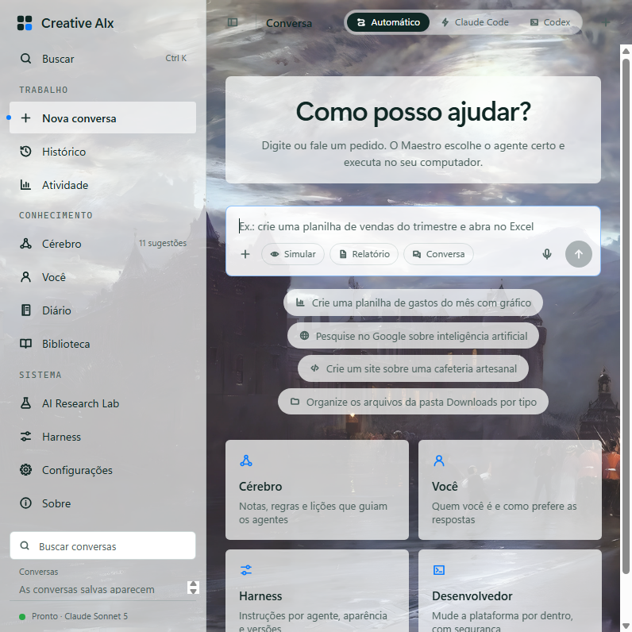

# Creative AIx

Windows desktop assistant that turns natural-language requests into planned, policy-checked actions on the
desktop, the browser, files, spreadsheets and code, with a local, editable knowledge vault.

[](LICENSE)


[](https://github.com/ognistie/CreativeAIx/actions/workflows/ci.yml)



## How it works

1. **Maestro** reads the request and the conversation, retrieves matching vault notes and plans the steps.
2. Deterministic **acceptance policies** (Python, not prompts) validate the plan before anything runs.
3. Domain agents (Desktop, Web, Data, Code, File, Claude Code / Codex) execute: deterministic routine first,
   Windows UI Automation second, vision only as a fallback.
4. Every step is verified and recorded; the outcome goes back to the vault as lessons and procedures you approve.

## Architecture

```
Qt window (PySide6)                                   python.exe
 ├─ QtWebEngine view  ── React UI (ui/dist) ──┐
 ├─ mini chat view    ── React UI ────────────┤ ws://127.0.0.1 (per-run token, JSON-RPC 2.0)
 └─ WindowMode, global hotkeys, voice         │
                                              ▼
                    desktop/server.py ─► BridgeCore ─► Controller ─► Maestro ─► agents ─► core
                                                                       │
                                                       vault/ (factory) + Documents/AI Farm Agent (personal)
```

- The UI runs inside signed processes (`python.exe`, `QtWebEngineProcess.exe`), so it works with Windows
  Smart App Control on.
- One contract for every UI: the Bridge methods and signals, frozen in
  `app/tests/fixtures/bridge_contract.txt` and generated to TypeScript in `ui/src/lib/contract.gen.ts`.
- Design tokens are generated from `app/desktop/qml/components/Theme.qml` (AA contrast checked in CI).
- The previous QML interface is still available with `--ui qt`. An optional Tauri shell lives in `ui/src-tauri`.

## Repository

| Path | Contents |
| --- | --- |
| `app/` | Python application: `core/`, `agents/`, `desktop/` (host, server, bridge), `tests/`, `scripts/` |
| `ui/` | React + TypeScript + Tailwind UI; `dist/` is the built UI the app loads |
| `vault/` | Factory knowledge vault (Obsidian): rules, policies, skills, playbooks, speech lexicon |
| `docs/` | Architecture notes, security review, research |
| `config.yaml` | Models, voice, UI shell, brain and privacy settings |

## Getting started

Requirements: Windows 10/11, Python 3.11, an Anthropic API key. Node.js 22 only to rebuild the UI.

```powershell
git clone https://github.com/ognistie/CreativeAIx.git
cd CreativeAIx
scripts\setup.ps1                  # venv from the reviewed lock, shortcuts, UI build if Node is present
Copy-Item .env.example .env        # set ANTHROPIC_API_KEY
.\.venv\Scripts\python.exe app\main.py
```

Hotkeys: `Ctrl+Alt+V` voice, `Ctrl+Alt+X` stop from any app, `Alt+Space` quick entry, `Ctrl+K` search.

UI development:

```powershell
cd ui
npm ci
npm run dev          # http://127.0.0.1:1420/?demo  (fake core, no Python)
npm run build        # updates ui/dist, loaded by the desktop app
```

## Quality gates

| Check | Command |
| --- | --- |
| Release gate (compile, 500+ tests, smoke, QML, vault) | `python app/scripts/check_release.py --code-only` |
| UI typecheck, tests, build | `cd ui; npm run typecheck; npm test; npm run build` |
| Real app, every screen captured offscreen | `python app/scripts/snapshot_web_ui.py <out-dir>` |
| Generated files in sync | `python app/scripts/export_tauri_contract.py --check` and `export_theme_tokens.py --check` |

## Security

The app acts with the current Windows user's permissions. Plans pass acceptance policies before execution,
tools are scoped per agent, deletions go to the recycle bin, generated code is not executed, and page or
window text is treated as data. The local UI server listens on loopback only, requires a per-run token and
an allowed origin. GUI effect-level authorization is still incomplete: use a dedicated environment.
See [SECURITY.md](SECURITY.md) and [docs/security-review.md](docs/security-review.md).

## License

[MIT](LICENSE). Contributions: [CONTRIBUTING.md](CONTRIBUTING.md).
