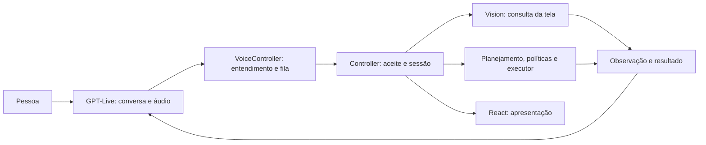

# Conversa, visão e execução — 19/11/2026

## Objetivo

Conversa natural com o GPT-Live, capaz de consultar a tela e acompanhar tarefas do Creative AIx,
com fatos compartilhados, execução única e permissões verificadas em código.

A API não replica automaticamente o produto ChatGPT: a aplicação implementa contexto, memória,
ferramentas, recuperação e avaliação. O GPT-Live conduz a fala; os modelos configurados para
interpretação, Maestro e Vision fazem o trabalho delegado.

## Falhas encontradas

1. O prompt afirmava que a voz não via a tela, apesar de existir um Vision no backend.
   A política de delegação também não mencionava perguntas sobre elementos visíveis.
2. `vendo ali o endereço` escapava da detecção de consulta visual. A conversa podia responder sem observar a janela.
3. O pedido falado dependia de backend → React → RPC → backend, com repetição pelo watchdog.
4. Delegação ou promessa do modelo transformavam um palpite sobre fala incompleta em comando.
5. Outro modelo reescrevia o resultado antes de devolvê-lo ao GPT-Live.
6. A conexão recebia somente o início de até 3.000 caracteres de contexto, perdendo dados recentes.
7. Callbacks e transcrições pendentes precisavam ser vinculados à geração e à conversa corretas.

## Fluxo implementado

- O núcleo devolve se aceitou a tarefa de voz. O evento `voiceCommand` apresenta uma execução já aceita;
  o React não a inicia novamente. O aceite verifica a conversa sob o lock que protege a execução.
- Perguntas visuais explícitas e detalhes de uma janela em contexto entram na rota de leitura. Uma pergunta
  genérica sem contexto visual não dispara captura automaticamente. Comandos misturados com leitura
  seguem pela execução normal e suas políticas.
- `answer` transporta resposta, observação, fonte, confiança, horário, execução e conversa. A voz recebe
  fatos pelo canal silencioso e solicita a fala. Falhas de leitura são comunicadas como falhas.
- Tarefas por voz dispensam a chamada de reescrita no `reply.compose`. O GPT-Live recebe o resultado e a
  indicação de verificação, preservando números e incertezas.
- Contexto atualizado usa uma posição separada, substituída pelo estado mais recente. Não ocupa a fila
  de resultados nem reabre uma conexão paga só para atualizar fatos.
- A reconexão conserva a parte recente e algumas falas antigas. É memória de trabalho limitada.
- Dados longos são fragmentados em blocos limitados. A solicitação de fala continua única.
- Delegação e promessas do modelo não autorizam palpites; a confirmação pertence à pessoa.
- Abrir outra conversa encerra a escuta e invalida pedidos, confirmações e callbacks antigos. A pessoa
  pode ligar a voz novamente na conversa escolhida.

## Contrato com o provedor

A [documentação oficial](https://developers.openai.com/api/docs/guides/live-delegation) orienta enviar
imagens ao backend visual e devolver conclusões textuais ao frontend Live. Na delegação cliente,
contexto, permissões e estado são responsabilidade da aplicação.

`session.thinking.append` fornece dados silenciosos; `session.commentary.append` solicita fala.
O identificador de delegação associa o retorno ao trabalho. Cada append tem teto de 500 tokens;
o código usa até 400 bytes UTF-8 mais um rótulo curto por bloco.

## Evidência e próxima evolução

`app/tests/test_voice_architecture.py` reproduz a frase do incidente, a consulta ao Vision, a entrega
do endereço à voz, a execução sem React, a recusa de conversa incorreta e limites de contexto.
Esses testes não usam microfone nem API paga. Fluidez auditiva, reconhecimento e interrupções exigem
uma sessão real. As mudanças não aumentam quotas nem ativam envio contínuo de capturas.

Validação local desta mudança:

- Gate completo: 594 testes Python aprovados, smoke aprovado e `CODE_READY True` / `MAIN_READY True`.
- Interface: 59 testes aprovados; checagem de tipos, build e carimbo do build aprovados.
- Host Qt com React compilado e sessão isolada: uma execução, nenhuma chamada duplicada pela interface,
  uma resposta visível e entrega do endereço ao canal de voz, sem erros JavaScript. Vision e saída de voz
  foram simulados; esta prova verifica a integração, não o reconhecimento real de imagem ou áudio.
- Uma execução do gate encontrou `WinError 5` ao substituir um arquivo temporário no teste do Lab.
  O caso isolado e o gate completo passaram na repetição; a causa desse acesso negado não foi determinada.

Próximos passos:

1. Medir fim da fala → interpretação → aceite → observação/execução → resposta útil, com percentis e falhas.
2. Reduzir a interpretação duplicada da conversa livre: hoje os turnos também passam pelo intérprete.
   Tratar delegação como solicitação de backend, com recuperação de eventos tardios, preservando a autorização.
3. Implementar resumo incremental persistente e recuperação do histórico por conversa. `Session` ainda
   limita os turnos ativos a 200; âncoras recentes não garantem lembrar todos os fatos por horas.
4. Apresentar duração e uso em sessões longas. A quota diária padrão de `LiveConfig` é 1.800 segundos,
   configurável. Não elevar o orçamento silenciosamente para manter a conversa por horas.
5. Avaliar diálogo prolongado, correções, nomes e números, tela ambígua, falhas do provedor, mudança de
   janela, confirmação de efeitos e reconexão. Verificar ações por resultado observável e naturalidade por pessoa.
